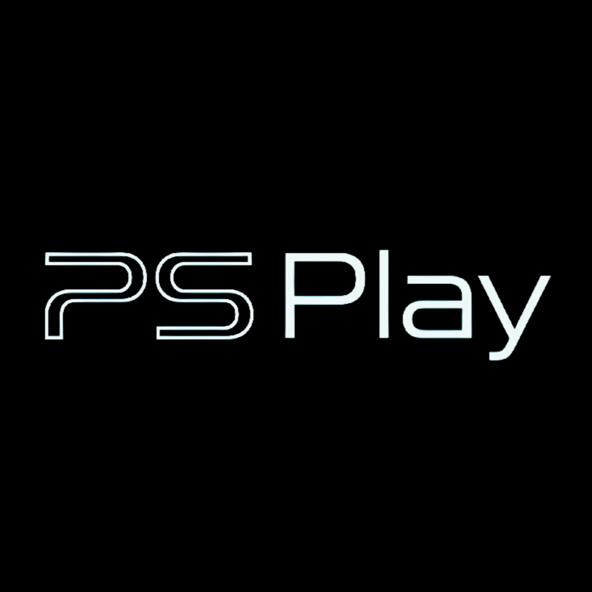

**An all-in-one mediahub, cloud gaming and homebrew hub for the PS5**

  
> PS Play is a native PS5 homebrew application (OpenGL, payload SDK) for jailbroken consoles. It brings streaming,
> music, cloud gaming, a homebrew shop, emulators, a web browser and file tools together in one app with one design,
> one controller layout and one place for every account.
  

-111111)

By **InsideMatrixDev**

---

## Contents
- [Highlights](#highlights)
- [Features](#features)
- [Requirements](#requirements)
- [Installation](#installation)
- [FAQ](#faq)
- [Reporting a bug](#reporting-a-bug)
- [Support the project](#support-the-project)
- [Privacy and security](#privacy-and-security)
- [Roadmap](#roadmap)
- [Credits and origins](#credits-and-origins)
- [Licences](#licences)
- [Disclaimer](#disclaimer)

## Highlights
- **One app instead of twenty**: video, music, cloud gaming, shop, emulators, browser and file tools share one interface.
- **Built for the controller**: every page works with the pad; text can also be typed from the phone.
- **Full-screen sign-in pages** for every service (form, code + QR, or step by step), credentials encrypted with a
  key tied to the console.
- **Phone companion**: a web panel on your network for typing, sign-ins, logs and link sharing.
- **QR codes everywhere**: wherever you would type or sign in, a QR code opens the right page on your phone, so text,
  passwords, keys and settings are entered from the phone instead of the on-screen keyboard.
- **Themes**: PS5-style home, Xbox Series X dashboard style, classic grid, animated backgrounds, icon packs and avatars.
- **Picture-in-picture everywhere**: keep any video playing in a corner while you use the rest of the app, even
  (muted) while you play in the cloud.
- **Background music**: the music player and the radio keep playing while you use any other part of the app.

## Features

> Features marked **🚧 Work in progress** are included and usable, but still being improved: expect rough edges.

### Video and streaming
| Feature | Details |
|---|---|
| **YouTube** | Browse, search, play; autoplay of the next video; picture-in-picture |
| **Stremio** | Addons, catalogues, films and series |
| **Nuvio** | Streams and catalogues |
| **Live platforms** | Twitch, Kick, Dailymotion, Odysee |
| **Media servers** | Jellyfin, Emby, Plex, Kodi |
| **IPTV** | M3U playlists |
| **DLNA** | Discovery and playback of local servers |
| **Tracking** | Trakt, Simkl, AniList, MDBList |
| **Debrid** | Real-Debrid, AllDebrid, TorBox, Premiumize |
| **Player** | Hardware video decoding, subtitles (local and online), audio tracks, resume |
| **Picture-in-picture** | Works with every media playback: all videos, IPTV channels, films and series, streams, and videos from the Gallery. Playback continues in a corner while you browse the app, and keeps going muted during cloud gaming (Xbox Cloud, GeForce NOW, Moonlight) |

### Music and audio
| Feature | Details |
|---|---|
| **Spotify Connect** 🚧 | PS Play appears as a speaker in the Spotify app. **Work in progress** |
| **YouTube Music** | Library, playlists and liked songs |
| **Music servers** | Subsonic / Navidrome, Audiobookshelf |
| **Podcasts** | Apple catalogue, Podcast Index, gPodder (also Nextcloud) |
| **Radio** | Radio Browser stations, RaiPlay Sound |
| **Free music** | Jamendo |
| **Scrobbling** | Last.fm and ListenBrainz |
| **Music player** | Full-featured player: library, albums, artists, playlists, covers, lyrics, tags, shuffle and repeat, equalizer, internet radio |
| **Background playback** | Music and radio keep playing while you use any other feature of the app |

### Cloud gaming and remote play
| Feature | Details |
|---|---|
| **Xbox Cloud Gaming** | Full game grid, queue and connection on the same page, streaming in PS Play |
| **GeForce NOW** | Catalogue and library, server search and queue on the same page |
| **Moonlight** | Stream games from your PC (Sunshine / GeForce Experience) |
| **Steam** | Your Steam library, played through Moonlight |
| **Remote Desktop** | VNC client |

### Games, shop and homebrew
| Feature | Details |
|---|---|
| **Shop** | Homebrew and game catalogues by section, download queue, automatic install |
| **Custom catalogues** | Add your own catalogues to the Shop: your personal apps and games, or catalogues from other PS5 projects |
| **Download manager** | Multi-connection downloads with resume; send a link from the phone with a QR code and the PS5 downloads it (the link must point to a file with an extension, e.g. `.pkg`, `.zip`, `.exfat`) |
| **File hosts** 🚧 | Links from file hosts; hosts protected by a Cloudflare check are passed in the PS5 browser. **Work in progress** |
| **PKG Installer** | Install `.pkg` from USB and internal storage |
| **Payload Hub** | Send payloads to the ELF loader |
| **Games** | Installed games with covers, launch, cheats and saves |
| **Emulators** | NES, Game Boy / Color, Master System, Mega Drive / Genesis, Atari 7800, PlayStation |
| **PlayStation 2** | Installer for Swordpdf's PS5SX2 |

### Files, cloud storage and reading
| Feature | Details |
|---|---|
| **File manager** | Internal storage, USB, archives (extraction), copy / move / delete |
| **Cloud storage** | Google Drive, Dropbox, MEGA, WebDAV, Synology; OneDrive 🚧 (**work in progress**) |
| **Torrent** | Built-in torrent client: download whatever you choose from torrents and magnet links, straight to the console |
| **Gallery** | Photos and videos, online photo services; **send any picture to your phone** (download it over the local network); videos play in picture-in-picture too |
| **Wallpapers** | Built-in wallpaper services to browse and set backgrounds |
| **Books** | E-books (Project Gutenberg and others) and manga (MangaDex) |
| **News** | Jailbreak scene news |

### Browser
| Feature | Details |
|---|---|
| **Web browser** 🚧 | Built-in engine, mobile versions of sites, reader mode, ad and tracker blocking. **Work in progress**: many modern sites are slow or do not work yet |
| **Downloads from pages** 🚧 | Files started on a page go to PS Play's download queue. **Work in progress** |

### System and personalisation
| Feature | Details |
|---|---|
| **Home** | PS5-style home, Xbox Series X dashboard style, classic grid |
| **Themes and animated backgrounds** | Several themes, animated and live backgrounds, your own pictures as wallpaper |
| **Notification panel** | Downloads, installs and service messages in one panel, reachable from anywhere (also during cloud games) |
| **Icon packs and avatars** | With live preview |
| **Phone web panel** | Typing, sign-ins, logs, link sharing |
| **QR codes across the app** | Scan to type text, sign in to services, paste keys and links, manage the app and download logs from the phone |
| **Voice commands** | Open pages and services by voice |
| **Search, screensaver** | Across the whole app |
| **Accessibility** | High contrast, reduced motion, larger text |
| **Diagnostics** | Logs, crash reports and recovery, self test, system detection, logs downloadable from the phone |
| **Built-in updater** | Check for and install new versions from inside the app (App info) |

## Requirements
- A PS5 with a working jailbreak and an **ELF loader** (port 9021) for the features that use payloads.
- Optional: **ShadowMount** for game images, an internet connection for online services.
- **Tested firmware: 4.00 to 13.60.**

## Installation
<!-- TODO: installation steps (folder copy / PKG), first start, where data is kept (/data/ps_play) -->

## FAQ

**Is PS Play a jailbreak or an exploit?**
No. PS Play is an application for consoles that are already jailbroken. It does not jailbreak anything by itself.

**Which firmware does it work on?**
It has been tested from 4.00 to 13.60. It needs a working jailbreak; some features also need an ELF loader on port 9021.

**Do I need a PC?**
No. Everything works from the console; the phone is optional (typing, sign-ins, links and logs through QR codes).
A PC is only needed for Moonlight (game streaming from your PC) and Remote Desktop.

**Where does PS Play keep its data?**
In `/data/ps_play` on the console: settings, accounts (encrypted), caches, downloads and logs.

**A service will not sign in. What can I do?**
Check the date and time of the console (a wrong clock breaks secure connections), try the sign-in through the QR code
on the phone, then send the logs (see [Reporting a bug](#reporting-a-bug)).

**Video stutters or does not start.**
Most often it is the network or the source. Try another source or quality; for IPTV and live streams, wired Ethernet
helps. If it keeps happening, send the logs right after it happens.

**Why is the browser slow on some sites?**
The browser is **work in progress**: it uses a light engine that runs inside PS Play. Many modern sites are heavy;
the mobile versions of sites (the default) and reader mode help.

**Can I add my own games and apps to the Shop?**
Yes: add your own catalogues in the Shop, or catalogues published by other PS5 projects.

**Does PS Play include games, BIOS or copyrighted content?**
No. PS Play does not include or host any games, BIOS files, firmware or keys.

**How do I update?**
Open **Settings → App info** and press **X** on the **Update** row: PS Play checks its official
[GitHub releases](https://github.com/MounirHero/PS-PLAY-App/releases), and downloads and installs the newest version.

## Reporting a bug
A good report gets fixed much faster. Please open an issue with:
1. **Your PS Play version** (Settings, top of the list) and **firmware**.
2. **What you did, what you expected, what happened** — step by step.
3. **The logs**: Settings › System › Logs, or scan the QR code there to **download them on your phone** (`psplay-logs.tar`).
   Send them right after the problem happens.
4. A **photo or screenshot** if something looks wrong.

Logs never contain your passwords, tokens or keys (see below), so they are safe to share.

You can also ask for help on the **[Discord server](https://discord.gg/3Ce2jft2H)**.

## Privacy and security
- **Your accounts stay on your console.** Passwords, tokens and keys are stored only in `/data/ps_play`, **encrypted**
  (AES-256) with a key created on and kept by your console.
- **Never in the logs.** Credentials are masked in every log and report.
- **No analytics, no tracking.** PS Play does not collect or send any data about you. It only talks to the services
  you choose to use, and to the catalogues you add.
- **The phone panel stays at home.** The web panel and the QR pages work only on your local network.
- **Sign out anytime**: every service has *Options › Sign out*, which deletes its saved credentials.

## Roadmap
Planned (order may change):
- [x] **Built-in updater**: download and install new versions from the app.
- [ ] **Shop**: automatic fallback to another source when a link is dead, and link checking before downloading.

- [ ] **Browser**: faster pages and better compatibility.
- [ ] **OneDrive**: sign-in with PS Play's own Microsoft app.
- [x] **Crash recovery**: reopen PS Play where you were after a crash, with a one-press log report.
- [x] **First-start detection** of the console's tools (loader, ShadowMount, storage, network); the first-start setup that uses it is being finished.

Being researched:
- [ ] **Steam Remote Play** without a PC-side streaming server.

## Credits and origins

PS Play stands on the work of many people. Thank you to all of them.

### The people behind PS Play
| Who | Contribution |
|---|---|
| **[InsideMatrixDev](https://ko-fi.com/insidematrixdev)** | **PS Play**: design, development and integration of the whole app; every feature not listed below, and the clients of the other services rebuilt and adapted for PS Play |
| **[KINGDKAK](https://github.com/KINGDKAK)** | **[ProsperoPlayer](https://github.com/KINGDKAK/ProsperoPlayer)**, the media player PS Play was originally based on |
| **[Swordpdf](https://github.com/Swordpdf)** | **[PS5SX2](https://github.com/Swordpdf/PS5SX2)** (PlayStation 2 on the PS5), installed from PS Play; suggested BlackBearReloaded's project as the base of PS Play Native GL |
| **[BlackBearReloaded](https://github.com/blackbearreloaded)** | ps5-homebrew-ui (the native UI base of PS Play), [ps5-opengl](https://github.com/blackbearreloaded/ps5-opengl), [PS5 Native App Boilerplate](https://github.com/blackbearreloaded/ps5-native-app-boilerplate), [ps5-at9-converter](https://github.com/blackbearreloaded/ps5-at9-converter) |
| **[Stuey-81](https://github.com/Stuey-81)** | **[Nuvio Portable](https://github.com/Stuey-81/Nuvio-Portable)**, from which PS Play's Stremio and Nuvio support were derived |
| **[nexgen999](https://github.com/nexgen999)** | The Shop's **PS5 payload catalogue** ([evoX-CoreOS](https://github.com/nexgen999/evoX-CoreOS)) and **homebrew app catalogue** ([PS5-Repository-List](https://github.com/nexgen999/PS5-Repository-List)) |

### Cloud gaming
| Component in PS Play | Origin | Author |
|---|---|---|
| Xbox Cloud Gaming stream (WebRTC session, input, audio/video) | [PSBox Cloud Gaming — xbox-cloud-gaming-ps5](https://github.com/RafaelNGP/xbox-cloud-gaming-ps5) | RafaelNGP |
| GeForce NOW client | [OpenNOW](https://github.com/OpenCloudGaming/OpenNOW), [OpenNOW-PS5](https://github.com/OpenCloudGaming/OpenNOW-PS5) / [Portablelle/OpenNOW-PS5](https://github.com/Portablelle/OpenNOW-PS5) | OpenCloudGaming, Portablelle |
| Moonlight client | The open [Moonlight](https://moonlight-stream.org/) game streaming protocol (works with [Sunshine](https://github.com/LizardByte/Sunshine)) | Moonlight Game Streaming Project; LizardByte |

### Media and music
| Component in PS Play | Origin | Author |
|---|---|---|
| Spotify Connect (Spot5) | [cspot](https://github.com/feelfreelinux/cspot), via the fork by [philippe44](https://github.com/philippe44/cspot) | feelfreelinux & alufers; philippe44; PS5 port **Spot5** by [abhi245y](https://github.com/abhi245y) |
| Stremio | [Stremio](https://www.stremio.com/) addon protocol | Stremio team |
| Nuvio | [Nuvio Portable](https://github.com/Stuey-81/Nuvio-Portable) | Stuey-81 |
| Video decoding | [FFmpeg](https://ffmpeg.org/) | FFmpeg developers |

### Emulators
| System | Core | Author |
|---|---|---|
| NES | [FCEUmm](https://github.com/libretro/libretro-fceumm) | FCEU / FCEUmm and libretro contributors |
| Game Boy / Color | [Gambatte](https://github.com/libretro/gambatte-libretro) | sinamas and contributors |
| Master System, Mega Drive / Genesis | [Genesis Plus GX](https://github.com/ekeeke/Genesis-Plus-GX) | Eke-Eke and contributors |
| Atari 7800 | [ProSystem](https://github.com/libretro/prosystem-libretro) | Greg Stanton and contributors |
| PlayStation | [PCSX ReARMed](https://github.com/libretro/pcsx_rearmed) | PCSX / PCSX ReARMed contributors |
| PlayStation 2 (installer) | [PS5SX2](https://github.com/Swordpdf/PS5SX2), built on [PCSX2](https://github.com/PCSX2/pcsx2) | Swordpdf; PCSX2 team |

### Browser
| Component | Origin | Author |
|---|---|---|
| Browser engine | [Northstar](https://github.com/nordstjernen-web/northstar-browser) | Andreas Røsdal |
| JavaScript | [QuickJS](https://bellard.org/quickjs/) | Fabrice Bellard, Charlie Gordon |
| HTML parser | [lexbor](https://github.com/lexbor/lexbor) | lexbor contributors |
| Networking | [libcurl](https://curl.se/), [OpenSSL](https://www.openssl.org/) | curl and OpenSSL projects |

### Platform and tools
| Component | Origin | Author |
|---|---|---|
| PS5 payload SDK | [ps5-payload-dev/sdk](https://github.com/ps5-payload-dev/sdk) | John Törnblom and contributors |
| PacBrew packages | [ps5-payload-dev/pacbrew-repo](https://github.com/ps5-payload-dev/pacbrew-repo) | ps5-payload-dev |
| SharpProspero, UFS2Tool | [SharpProspero](https://github.com/SvenGDK/SharpProspero), [UFS2Tool](https://github.com/SvenGDK/UFS2Tool) | SvenGDK |
| MkPFS | [MkPFS](https://github.com/PSBrew/MkPFS) | PSBrew |
| **Voice commands (speech recognition)** | [whisper.cpp](https://github.com/ggml-org/whisper.cpp) (OpenAI Whisper, on-device) | Georgi Gerganov and contributors; OpenAI (Whisper model) |
| Spotify discovery (mDNS) | [mdnsd / mdnssvc](https://github.com/troglobit/mdnsd) | Tobias Blomberg and contributors |
| QR codes | Minimal QR encoder, based on [QR Code generator](https://www.nayuki.io/page/qr-code-generator-library) | Project Nayuki |
| Fonts | [Inter](https://github.com/rsms/inter), [Montserrat](https://github.com/JulietaUla/Montserrat) | Rasmus Andersson; Julieta Ulanovsky |
| Font baking, audio decoding | [stb](https://github.com/nothings/stb) | Sean Barrett |

### Online services
PS Play talks to the public APIs of many services (YouTube, Twitch, Kick, Dailymotion, Odysee, Jellyfin, Plex, Emby,
Trakt, Simkl, AniList, MDBList, Real-Debrid, AllDebrid, TorBox, Premiumize, Last.fm, ListenBrainz, Jamendo, Radio
Browser, Podcast Index, gPodder, MangaDex, Project Gutenberg, OneDrive, Google Drive, Dropbox, MEGA, Steam, Xbox,
NVIDIA). All trademarks belong to their owners; PS Play is not affiliated with or endorsed by any of them.

> The full list of components, versions and licence texts is in [THIRD_PARTY_NOTICES.md](THIRD_PARTY_NOTICES.md).

## Support the project
If PS Play is useful to you, you can support its development:
- **Ko-fi**: [ko-fi.com/insidematrixdev](https://ko-fi.com/insidematrixdev)
- **Solana (SOL)**: `Esd5LdC6HjvHYWJrufrH2FessgLRyupHVSKbHdLC3Bna`

## Licences
PS Play includes components under different licences, among them **GPL-3.0** (cspot / Spot5, OpenNOW, PSBox Cloud
Gaming, Northstar), MIT, BSD and OFL (fonts). Where GPL code is included, PS Play's corresponding source code is
published under the same terms. <!-- TODO: PS Play's own licence -->

## Disclaimer
PS Play is an independent homebrew project, not affiliated with Sony Interactive Entertainment, Microsoft, NVIDIA,
Valve, Spotify, Google or any other company named here. Use it only with content you have the right to access.
