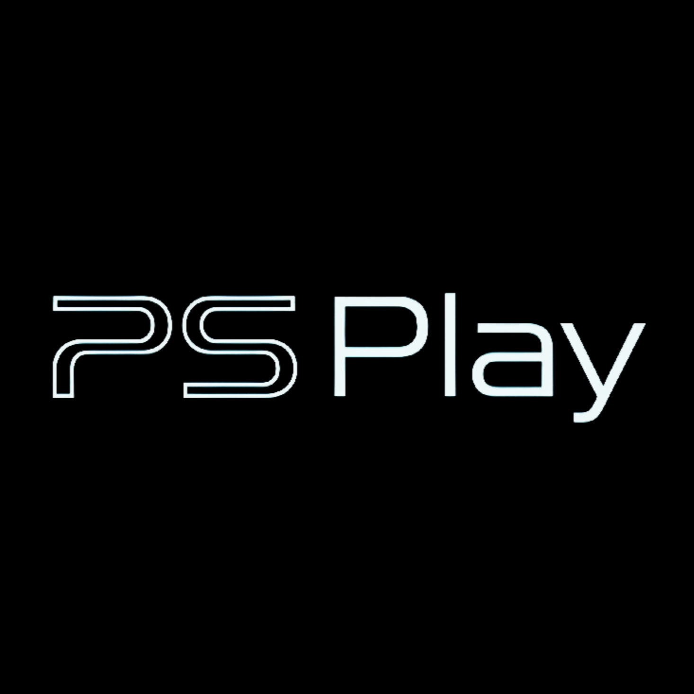

**An all-in-one mediahub, cloud gaming and homebrew hub for the PS5**

  
> PS Play is a native PS5 homebrew application (OpenGL, payload SDK) for jailbroken consoles. It brings streaming,
> music, cloud gaming, a homebrew shop, emulators, a web browser and file tools together in one app with one design,
> one controller layout and one place for every account.
  
-2f6fed)  -111111) 

 

By **InsideMatrixDev**

---

## Contents
- [Highlights](#highlights)
- [What's new in 1.005](#whats-new-in-1005)
- [Features](#features)
- [Requirements](#requirements)
- [Installation](#installation)
- [FAQ](#faq)
- [Reporting a bug](#reporting-a-bug)
- [Privacy and security](#privacy-and-security)
- [Credits and origins](#credits-and-origins)

## Highlights
- **One app instead of twenty**: video, music, cloud gaming, games and homebrew tools, a social space, files and
  downloads share one interface, one controller layout and one place for every account.
- **Built for the controller and the TV**: every page works with the pad; text can also be typed from the phone.
- **Your phone as a companion**: a web panel on your network (and a QR code wherever you would type or sign in).
- **Seven home themes plus the PS5 one**, icon packs, live wallpapers and per-theme options.
- **Games and homebrew tools in one place**: PKG Matrix, a cheat engine, save backups, emulators and a homebrew
  shop that reads third-party catalogues.
- **Background playback and picture-in-picture**: music, radio and Spotify keep playing while you use the rest of
  the app; any video can keep playing in a corner.

## What's new in 1.005
- **Spotify Connect**: the PS5 shows up as "PS Play" in the Spotify app on your phone; the music plays on the
  console, with what is playing, play / pause / next and your Home and Library on the TV (Spotify Premium).
- **PS Play Social**: friends, private chats, groups and a global chat, reactions, replies, read receipts, file
  sharing, a lobby showing what your friends are doing, and the web version at social.insidematrixdev.com.
- **Redesigned settings**: nine clear sections (General, Appearance, Playback, Audio, Devices, Accounts, Content,
  System, Storage), a search, and an Accounts section where every service shows its sign-in state.
- **PKG Matrix**: every app folder, image and PKG on every drive, with the tools to build images and packages.
- **Cheats**: a cheat engine for the game you are playing, with the GoldHEN and etaHEN PS5 databases.
- **New web panel**: a control panel for the phone with your games, media, files, downloads and tools.
- **Receivers**: DLNA, AirPlay, Miracast and YouTube casting, with the console's own name on your network.
- **Home themes**: Nintendo Switch (dark / light), PS4, Steam and Inferno themes, plus wallpaper dimming, an
  accent tint and dark edges for every theme.

## Features

### Video and streaming
- YouTube with its own TV sign-in (QR) and your library; Twitch, Kick, Vimeo, Dailymotion and PeerTube links.
- Movies and series through **Stremio and Nuvio add-ons** and their catalogues, with **Real-Debrid, AllDebrid,
  TorBox and Premiumize** (sign-in with a code or QR), Trakt, Simkl, AniList and MDBList.
- Media servers: **Plex, Jellyfin, Emby, Kodi**; IPTV with **Xtream Codes**, **Tvheadend** and free TV channels.
- Hardware video decoding, HDR tone mapping, upscaling, subtitles (with automatic translation and subtitles from
  the audio), skip intro, resume, next episode and a daily limit for children.
- **Recents** with a frame or cover for everything you played.

### Music and audio
- **Spotify Connect** (see above) and **YouTube Music** with its own account: your library, playlists and liked songs.
- Radio stations, podcasts (Podcast Index, gpodder / Nextcloud), Jamendo, **Navidrome / Subsonic** and
  **Audiobookshelf**; scrobbling to Last.fm and ListenBrainz; song recognition with AcoustID.
- Equaliser, night mode, Bluetooth audio devices, controller audio and a sleep timer.

### Cloud gaming and remote play
- **Xbox Cloud Gaming** and **GeForce NOW**; **Moonlight** for the games on your PC; a remote desktop (VNC).
- Picture-in-picture: keep a video playing (muted) while you play in the cloud.

### Games and homebrew
- **Game library** with covers and a page for every game: launch, cheats, saves and information; "return to PS Play
  after a game".
- **PKG Matrix**: app folders, game images and PKG files on every drive (internal and USB). Build a **.ffpkg** image
  (UFS2, for ShadowMountPlus), **backport** an image to your console's firmware, and build a **PS4 game as a .pkg**.
- **Cheat engine**: turn cheats on and off from a game's page while the game runs (the original bytes come back
  when it stops). Databases from **GoldHEN** and **etaHEN PS5**, updated every week, only for your game version if
  you like, and your own cheat files.
- **Saves**: background backups, back up everything now, export and import decrypted saves, edit them with a hex
  editor, backups on USB.
- **Homebrew shop** with **third-party catalogues**: add any compatible catalogue from a link (NexGen and others),
  install and update homebrew, and keep the payload catalogue up to date.
- **Payloads**: send ELF payloads to the console's loader, with their own catalogue and updates.
- **Emulators**: PS1 and PS2 Classics (with a guide), a PS3 emulator, retro systems and RetroAchievements.
- **File host downloads**: when a file host puts a browser check (Cloudflare) in front of a download, you pass it in
  the PS5 browser and a small scanner payload picks up the session, so the download continues in PS Play.

### PS Play Social
- Friends and friend requests, private chats (from friends, or from nobody), groups (public, private, with an
  invite code) and the global chat.
- Reactions, replies, read receipts (that you can turn off), mute a chat, delete a chat for yourself only.
- Share files with friends, see what they are playing ("what I am playing", optional), notifications.
- The same account on the web at **social.insidematrixdev.com**, with "Your PS5": your console's web panel one tap away.
- Community rules and moderation (reports, bans); the rules state what moderators can read.

### Phone, network and receivers
- **Web panel** on your network: your games and what to continue, media, files (browse, upload, download),
  downloads, payloads, logs, the console's keyboard and pad, and app updates.
- **Receivers**: DLNA renderer, AirPlay, Miracast and YouTube casting, each one on or off, with the console's
  name on your network.
- **Android Link**: your Android phone and the console working together.
- Network test and the network speed in the top bar.

### Files, cloud storage and downloads
- File manager for the internal storage and USB drives.
- **OneDrive, Dropbox, Google Drive, MEGA, WebDAV / Nextcloud** and **Synology**.
- Downloads with a schedule, a speed limit, a mirror of your choice, simultaneous downloads and rest mode at the
  end; torrents built in, plus **qBittorrent, Transmission, Prowlarr, Jackett, Sonarr and Radarr**.

### Reading and photos
- **MangaDex** (no account), **Komga, Kavita** and **Calibre-Web / OPDS** catalogues; ebooks and comics.
- Photos from **Immich**, **NASA** and **Unsplash** (also for the screensaver and as wallpapers), the gallery of
  your console and USB drives, IP cameras (RTSP and ONVIF).

### Home themes and personalisation
- **Home themes**: PS5 (default), **PS4**, **PS3 XMB** (the wave, drawn or as video, in your colour),
  **Xbox Series** (with ConsoleDash wallpapers), **Nintendo Switch** (dark or light), **Steam**, **Shelf** and
  **Inferno** (fire colour and embers).
- **Theme settings** for every theme: background, accent colour, theme sounds, wallpaper dimming, accent tint and
  dark edges, plus each theme's own options (tile size, card count, wave colour...).
- **Icon packs**, icon size and shape, avatars, live wallpapers (particles, Matrix, music and more), ready-made
  themes and "save the look as a theme".

### Settings, accessibility and family
- Settings in nine sections with search; every service's account in one place.
- Screen reader, voice commands (hold L3, with your own commands), high contrast, text size and reduced motion.
- Parental controls (PIN, daily video limit); controller vibration, adaptive triggers and light bar.

### System
- In-app updates from the web panel, and **go back to the previous version** if an update misbehaves.
- Settings backup and restore, storage overview, cache and covers, power saving and a photo screensaver.
- Logs you can send to your phone in one tap, detailed logs, statistics and plugins.

## Requirements
- A PS5 with jailbreak and an **ELF loader** on port 9021 (needed by payloads, the cheat engine, saves and Spotify's
  pairing).
- **ShadowMountPlus** for .ffpkg images and game images; an internet connection for online services.
- **Spotify Premium** for Spotify Connect.
- **Tested firmware: 4.00 to 13.60.**

## Installation
- **As an image**: copy `LAPY47000.ffpkg` (from the release) into `/data/homebrew/`; ShadowMountPlus mounts it.
- **As a folder**: copy the `LAPY47000` folder (from the release, or from this repository) to the console.
- **Updates**: upload the new image from the web panel (Update), then exit PS Play from its Home (Circle, Exit) and
  open it again, so the new image is mounted.
- Your data lives in `/data/ps_play` (settings, accounts, caches and logs).

### The app folder in this repository (`LAPY47000/`)
The folder is the app as it goes on the console. `eboot.bin` is stored with Git LFS: clone with git-lfs, or download
it from its own page.
`sce_module/libc.prx` is **not included**: it is a Sony system module and cannot be redistributed here. Copy it into
`LAPY47000/sce_module/` from another PS5 homebrew app that ships one, then copy the folder to the console.

## FAQ

**Is PS Play a jailbreak or an exploit?**
No. PS Play is an application for consoles that are already jailbroken. It does not jailbreak anything by itself.

**Which firmware does it work on?**
It has been tested from 4.00 to 13.60. It needs a working jailbreak; some features also need the ELF loader.

**Do I need a PC?**
No. Everything works from the console; the phone is optional (typing, sign-ins, links and logs through QR codes).
A PC is only needed for Moonlight (game streaming from your PC) and Remote Desktop.

**Where does PS Play keep its data?**
In `/data/ps_play` on the console: settings, accounts (encrypted), caches, downloads and logs.

**A service will not sign in. What can I do?**
Check the date and time of the console (a wrong clock breaks secure connections), try the sign-in through the QR code
on the phone, if it doesn't work then send the logs (see [Reporting a bug](#reporting-a-bug)).

**Video stutters or does not start.**
Most often it is the network or the source. Try another source or quality; for IPTV and live streams, wired Ethernet
helps. If it keeps happening, send the logs right after it happens.

**Why is the browser slow on some sites?**
The browser is **work in progress**: it uses a light engine that runs inside PS Play. Many modern sites are heavy;
the mobile versions of sites (the default) and reader mode help.

**Can I add my own games and apps to the Shop?**
Yes: add your own catalogues in the Shop, or catalogues published by other PS5 projects.

**Does PS Play include games, BIOS or copyrighted content?**
No. PS Play does not include or host any games, BIOS files, firmware or keys.

**How do I update?**
Open **Settings → App info** and press **X** on the **Update** row: PS Play checks its official
[GitHub releases](https://github.com/MounirHero/PS-PLAY-App/releases), and downloads and installs the newest version.

## Reporting a bug
A good report gets fixed much faster. Please open an issue with:
1. **Your PS Play version** (Settings, top of the list) and **firmware**.
2. **What you did, what you expected, what happened** — step by step.
3. **The logs**: Settings › System › Logs, or scan the QR code there to **download them on your phone** (`psplay-logs.tar`).
   Send them right after the problem happens.
4. A **photo or screenshot** if something looks wrong.

Logs never contain your passwords, tokens or keys (see below), so they are safe to share.

You can also ask for help on the **[Discord server](https://discord.gg/3Ce2jft2H)**.

## Privacy and security
- **Your accounts stay on your console.** Passwords, tokens and keys are stored only in `/data/ps_play`, **encrypted**
  (AES-256) with a key created on and kept by your console.
- **Never in the logs.** Credentials are masked in every log and report.
- **No analytics, no tracking.** PS Play does not collect or send any data about you. It only talks to the services
  you choose to use, and to the catalogues you add.
- **The phone panel stays at home.** The web panel and the QR pages work only on your local network.
- **Sign out anytime**: every service has *Options › Sign out*, which deletes its saved credentials.

## Roadmap
Planned (order may change):
- [x] **Built-in updater**: download and install new versions from the app.
- [ ] **Shop**: automatic fallback to another source when a link is dead, and link checking before downloading.

- [ ] **Browser**: faster pages and better compatibility.
- [x] **OneDrive**: sign-in with PS Play's own Microsoft app.
- [x] **Crash recovery**: reopen PS Play where you were after a crash, with a one-press log report.
- [x] **First-start detection** of the console's tools (loader, ShadowMount, storage, network); the first-start setup that uses it is being finished.

Being researched:
- [ ] **Steam Remote Play** without a PC-side streaming server.

## Credits and origins

PS Play stands on the work of many people. Thank you to all of them.

### The people behind PS Play
| Who | Contribution |
|---|---|
| **[InsideMatrixDev](https://ko-fi.com/insidematrixdev)** | **PS Play**: design, development and integration of the whole app; every feature not listed below, and the clients of the other services rebuilt and adapted for PS Play |
| **[KINGDKAK](https://github.com/KINGDKAK)** | **[ProsperoPlayer](https://github.com/KINGDKAK/ProsperoPlayer)**, the media player PS Play was originally based on |
| **[Swordpdf](https://github.com/Swordpdf)** | **[PS5SX2](https://github.com/Swordpdf/PS5SX2)** (PlayStation 2 on the PS5), installed from PS Play; suggested BlackBearReloaded's project as the base of PS Play Native GL |
| **[BlackBearReloaded](https://github.com/blackbearreloaded)** | ps5-homebrew-ui (the native UI base of PS Play), [ps5-opengl](https://github.com/blackbearreloaded/ps5-opengl), [PS5 Native App Boilerplate](https://github.com/blackbearreloaded/ps5-native-app-boilerplate), [ps5-at9-converter](https://github.com/blackbearreloaded/ps5-at9-converter) |
| **[Stuey-81](https://github.com/Stuey-81)** | **[Nuvio Portable](https://github.com/Stuey-81/Nuvio-Portable)**, from which PS Play's Stremio and Nuvio support were derived |
| **[nexgen999](https://github.com/nexgen999)** | The Shop's **PS5 payload catalogue** ([evoX-CoreOS](https://github.com/nexgen999/evoX-CoreOS)) and **homebrew app catalogue** ([PS5-Repository-List](https://github.com/nexgen999/PS5-Repository-List)) |

### Cloud gaming
| Component in PS Play | Origin | Author |
|---|---|---|
| Xbox Cloud Gaming stream (WebRTC session, input, audio/video) | [PSBox Cloud Gaming — xbox-cloud-gaming-ps5](https://github.com/RafaelNGP/xbox-cloud-gaming-ps5) | RafaelNGP |
| GeForce NOW client | [OpenNOW](https://github.com/OpenCloudGaming/OpenNOW), [OpenNOW-PS5](https://github.com/OpenCloudGaming/OpenNOW-PS5) / [Portablelle/OpenNOW-PS5](https://github.com/Portablelle/OpenNOW-PS5) | OpenCloudGaming, Portablelle |
| Moonlight client | The open [Moonlight](https://moonlight-stream.org/) game streaming protocol (works with [Sunshine](https://github.com/LizardByte/Sunshine)) | Moonlight Game Streaming Project; LizardByte |

### Media and music
| Component in PS Play | Origin | Author |
|---|---|---|
| Spotify Connect (Spot5) | [cspot](https://github.com/feelfreelinux/cspot), via the fork by [philippe44](https://github.com/philippe44/cspot) | feelfreelinux & alufers; philippe44; PS5 port **Spot5** by [abhi245y](https://github.com/abhi245y) |
| Stremio | [Stremio](https://www.stremio.com/) addon protocol | Stremio team |
| Nuvio | [Nuvio Portable](https://github.com/Stuey-81/Nuvio-Portable) | Stuey-81 |
| Video decoding | [FFmpeg](https://ffmpeg.org/) | FFmpeg developers |
| Bluetooth (Ghost-tooth) |  by StonedModder (https://github.com/StonedModder?tab=repositories)

### Emulators
| System | Core | Author |
|---|---|---|
| NES | [FCEUmm](https://github.com/libretro/libretro-fceumm) | FCEU / FCEUmm and libretro contributors |
| Game Boy / Color | [Gambatte](https://github.com/libretro/gambatte-libretro) | sinamas and contributors |
| Master System, Mega Drive / Genesis | [Genesis Plus GX](https://github.com/ekeeke/Genesis-Plus-GX) | Eke-Eke and contributors |
| Atari 7800 | [ProSystem](https://github.com/libretro/prosystem-libretro) | Greg Stanton and contributors |
| PlayStation | [PCSX ReARMed](https://github.com/libretro/pcsx_rearmed) | PCSX / PCSX ReARMed contributors |
| PlayStation 2 (installer) | [PS5SX2](https://github.com/Swordpdf/PS5SX2), built on [PCSX2](https://github.com/PCSX2/pcsx2) | Swordpdf; PCSX2 team |

### Browser
| Component | Origin | Author |
|---|---|---|
| Browser engine | [Northstar](https://github.com/nordstjernen-web/northstar-browser) | Andreas Røsdal |
| JavaScript | [QuickJS](https://bellard.org/quickjs/) | Fabrice Bellard, Charlie Gordon |
| HTML parser | [lexbor](https://github.com/lexbor/lexbor) | lexbor contributors |
| Networking | [libcurl](https://curl.se/), [OpenSSL](https://www.openssl.org/) | curl and OpenSSL projects |

### Platform and tools
| Component | Origin | Author |
|---|---|---|
| PS5 payload SDK | [ps5-payload-dev/sdk](https://github.com/ps5-payload-dev/sdk) | John Törnblom and contributors |
| PacBrew packages | [ps5-payload-dev/pacbrew-repo](https://github.com/ps5-payload-dev/pacbrew-repo) | ps5-payload-dev |
| SharpProspero, UFS2Tool | [SharpProspero](https://github.com/SvenGDK/SharpProspero), [UFS2Tool](https://github.com/SvenGDK/UFS2Tool) | SvenGDK |
| MkPFS | [MkPFS](https://github.com/PSBrew/MkPFS) | PSBrew |
| **Voice commands (speech recognition)** | [whisper.cpp](https://github.com/ggml-org/whisper.cpp) (OpenAI Whisper, on-device) | Georgi Gerganov and contributors; OpenAI (Whisper model) |
| Spotify discovery (mDNS) | [mdnsd / mdnssvc](https://github.com/troglobit/mdnsd) | Tobias Blomberg and contributors |
| QR codes | Minimal QR encoder, based on [QR Code generator](https://www.nayuki.io/page/qr-code-generator-library) | Project Nayuki |
| Fonts | [Inter](https://github.com/rsms/inter), [Montserrat](https://github.com/JulietaUla/Montserrat) | Rasmus Andersson; Julieta Ulanovsky |
| Font baking, audio decoding | [stb](https://github.com/nothings/stb) | Sean Barrett |

### Online services
PS Play talks to the public APIs of many services (YouTube, Twitch, Kick, Dailymotion, Odysee, Jellyfin, Plex, Emby,
Trakt, Simkl, AniList, MDBList, Real-Debrid, AllDebrid, TorBox, Premiumize, Last.fm, ListenBrainz, Jamendo, Radio
Browser, Podcast Index, gPodder, MangaDex, Project Gutenberg, OneDrive, Google Drive, Dropbox, MEGA, Steam, Xbox,
NVIDIA). All trademarks belong to their owners; PS Play is not affiliated with or endorsed by any of them.

> The full list of components, versions and licence texts is in [THIRD_PARTY_NOTICES.md](THIRD_PARTY_NOTICES.md).

## Support the project
If PS Play is useful to you, you can support its development:
- **Ko-fi**: [ko-fi.com/insidematrixdev](https://ko-fi.com/insidematrixdev)
- **Solana (SOL)**: `Esd5LdC6HjvHYWJrufrH2FessgLRyupHVSKbHdLC3Bna`

## Licences
PS Play includes components under different licences, among them **GPL-3.0** (cspot / Spot5, OpenNOW, PSBox Cloud
Gaming, Northstar), MIT, BSD and OFL (fonts). Where GPL code is included, PS Play's corresponding source code is
published under the same terms. <!-- TODO: PS Play's own licence -->

## Disclaimer
PS Play is an independent homebrew project, not affiliated with Sony Interactive Entertainment, Microsoft, NVIDIA,
Valve, Spotify, Google or any other company named here. Use it only with content you have the right to access.
